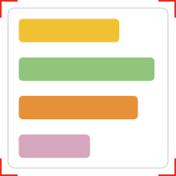

<picture>
  <source media="(prefers-color-scheme: dark)" srcset="assets/banner-dark.svg">
  <source media="(prefers-color-scheme: light)" srcset="assets/banner-light.svg">
  
</picture>

I build agentic systems that sit inside real workflows: automation, tooling and the feedback loops that keep products reliable at scale.

## Experience

**Founding Forward Deployed Engineer** · [Augmeta](https://www.augmeta.ai) May 2026 – present

Decision intelligence for digital commerce.

**Technical Product Support Manager** · Hiya 2024 – 2026

- Built a redress tool that cut resolution time from 48 hours to 4
- Cleared a 1,000-ticket backlog
- Built AI-powered support automation, triage and routing

## Education

**BS, Electrical & Computer Engineering** · University of Washington **Graduate CS coursework (AI)** · University of Illinois Urbana-Champaign

## Open source

AI-native operating systems for [Claude Code](https://claude.com/claude-code): plain markdown, local-first, driven by conversation instead of forms.

- **[career-os](https://github.com/ahmadelswify/career-os)**: tailored resumes, STAR stories, interview prep and application tracking
- **[work-os](https://github.com/ahmadelswify/work-os)**: brain-dump backlog, tasks, goals and daily planning

## Contact

 
