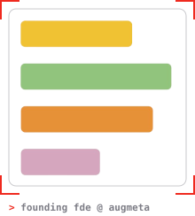

<picture>
  <source media="(prefers-color-scheme: dark)" srcset="assets/banner-dark.svg">
  <source media="(prefers-color-scheme: light)" srcset="assets/banner-light.svg">
  
</picture>

### `> whoami`

Forward deployed engineer. I build agentic systems that sit inside real workflows: automation, tooling and the feedback loops that keep products reliable at scale.

- **Now:** Founding Forward Deployed Engineer at **Augmeta** (May 2026–), decision intelligence for digital commerce
- **Before:** technical product operations at **Hiya** (2024–2026): triage and routing, self-serve resolution, AI-powered support automation. Built a redress tool that cut resolution time from 48 hours to 4, and cleared a 1,000-ticket backlog.
- **Education:** BS Electrical & Computer Engineering, University of Washington · graduate CS coursework (AI), UIUC

### `> ls ~/systems`

AI-native operating systems for [Claude Code](https://claude.com/claude-code): plain markdown, local-first, driven by conversation instead of forms.

| | system | what it does |
|---|---|---|
| `▸` | **[career-os](https://github.com/ahmadelswify/career-os)** | Tailored resumes, STAR stories, interview prep and application tracking |
| `▸` | **[work-os](https://github.com/ahmadelswify/work-os)** | Brain-dump backlog, tasks, goals and daily planning |

### `> contact`

 

<code>banner: an ASCII glyph field, baked to SVG by <a href="tools/banner.mjs">tools/banner.mjs</a></code>
